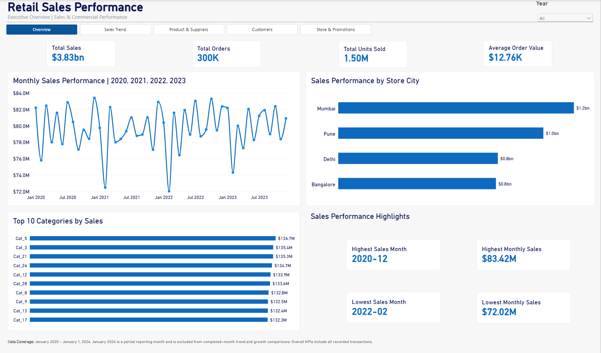
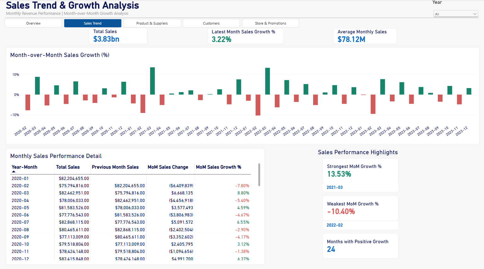
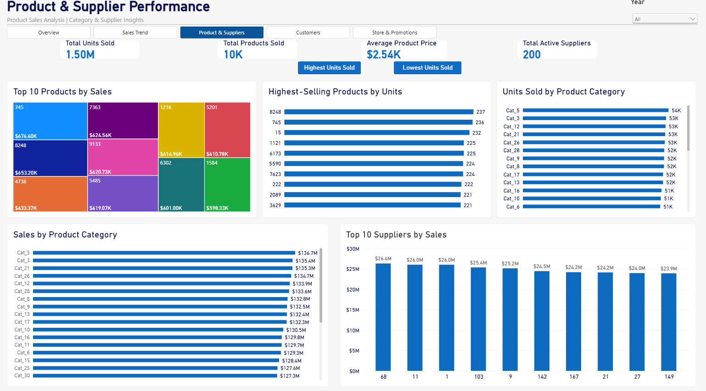
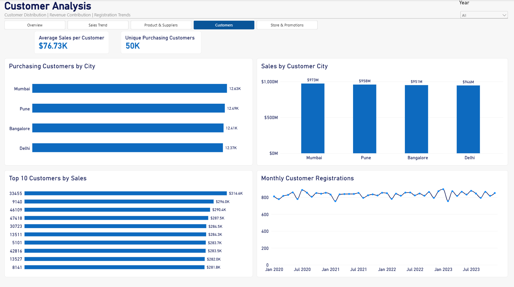
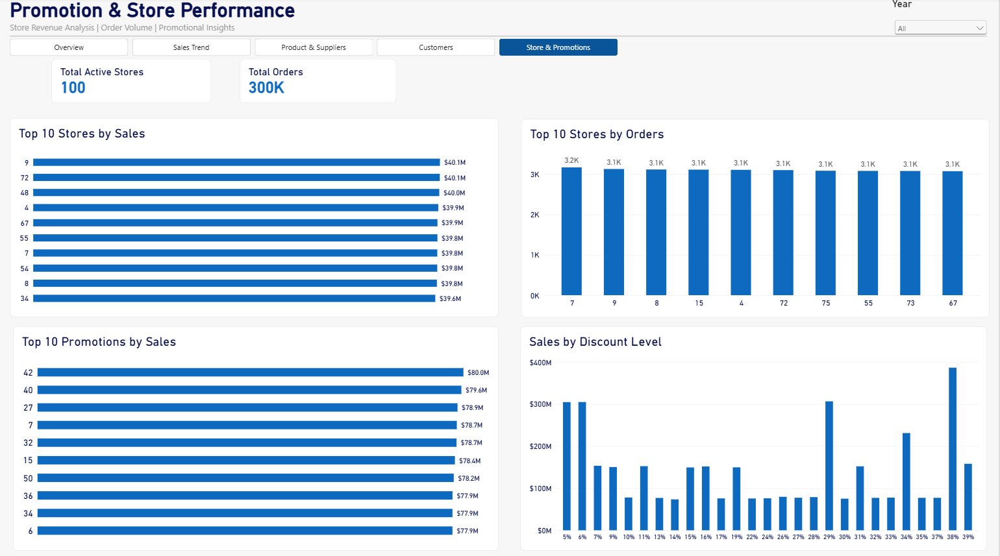

# Retail Sales Performance | Power BI Analytics Dashboard

## Project Overview

Developed a five-page interactive Power BI dashboard to analyze retail sales performance, customer purchasing behavior, product and supplier contributions, store operations, and promotional activity.

The project transforms transactional retail data into actionable business insights through data modeling, DAX calculations, time intelligence, and executive-focused visualizations.

## Explore the Power BI Dashboard

**[Download the Interactive Power BI Dashboard (.pbix)](PowerBI/Retail_Sales_Performance.pbix)**

Download the Power BI project file and open it using Microsoft Power BI Desktop to explore the complete five-page interactive dashboard.

**Dashboard features:**
- Interactive Year slicers for filtering report data.
- Navigation across five analytical pages.
- Dynamic KPI cards and performance visualizations.
- Month-over-month sales growth analysis.
- Product-ranking bookmarks for switching between highest- and lowest-selling products.

**Note:** Power BI Desktop is required to open the `.pbix` file. Dashboard screenshots are available below for visitors who do not have Power BI installed.

## Business Objectives

- Monitor revenue, order volume, units sold, and average order value.
- Evaluate monthly sales trends and month-over-month growth.
- Identify top-performing products, categories, and suppliers.
- Analyze customer purchasing patterns and geographic revenue contributions.
- Assess store performance and sales distribution across promotional discount levels.

## Executive Performance Snapshot

| KPI | Result |
|---|---|
| Total Sales | $3.83 billion |
| Total Orders | 300,000 |
| Total Units Sold | 1.50 million |
| Average Order Value | $12.76K |
| Unique Purchasing Customers | 50,000 |
| Active Stores | 100 |
| Active Suppliers | 200 |

*Figures reflect the full dataset with the Year filter set to All.*

## Dashboard Pages

### 1. Executive Overview

Provides a consolidated view of revenue, orders, units sold, average order value, monthly sales performance, leading product categories, and geographic sales contributions.

### 2. Sales Trend & Growth Analysis

Analyzes monthly revenue trends, month-over-month sales changes, growth rates, and strongest and weakest periods.

### 3. Product & Supplier Performance

Evaluates leading products by revenue and units sold, category performance, supplier contributions, and product pricing.

Includes interactive bookmarks to switch between highest-selling and lowest-selling products by units sold.

### 4. Customer Analysis

Examines purchasing customers by city, geographic revenue distribution, leading customers, and monthly customer registrations.

### 5. Store & Promotion Performance

Compares stores by revenue and order volume, identifies leading promotions, and examines sales across discount levels.

## Key Business Insights

- **Revenue:** Total recorded sales reached approximately $3.83 billion across 300,000 orders.
- **Geographic performance:** Mumbai generated the highest sales among the four cities displayed, at approximately $1.2 billion.
- **Monthly performance:** December 2020 recorded the highest completed-month sales of approximately $83.42 million, while February 2022 recorded the lowest at approximately $72.02 million.
- **Sales growth:** The strongest month-over-month growth was 13.53% in March 2021, while the weakest was -10.40% in February 2022.
- **Customers:** Approximately 50,000 unique customers made purchases, with average sales per purchasing customer of approximately $76.73K.

These findings are descriptive and should not be interpreted as evidence of causation.

## Tools and Technical Skills

- **Power BI Desktop:** Interactive dashboards, report design, slicers, and bookmarks.
- **Power Query:** Data preparation and transformation.
- **DAX:** Measures, filter context, time intelligence, and ranking calculations.
- **Data Modeling:** Relationships across orders, order items, products, customers, stores, promotions, suppliers, and a dedicated calendar table.
- **Business Analytics:** Revenue analysis, growth measurement, customer segmentation, and performance benchmarking.

## Data Coverage and Reporting Considerations

The dataset contains transactions from January 2020 through January 1, 2024.

January 2024 is a partial reporting month and is excluded from completed-month trend and growth comparisons. Overall sales KPIs include all recorded transactions.

## Project Files

Dashboard screenshots are available in the `Screenshots` folder.

The interactive Power BI report file may be added separately after confirming file size and public-sharing suitability.

## Author

Power BI | Financial Analysis | Business Intelligence | Data Analytics

*Portfolio project demonstrating end-to-end retail performance analysis and executive dashboard development.*
